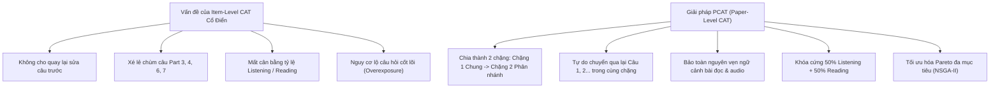
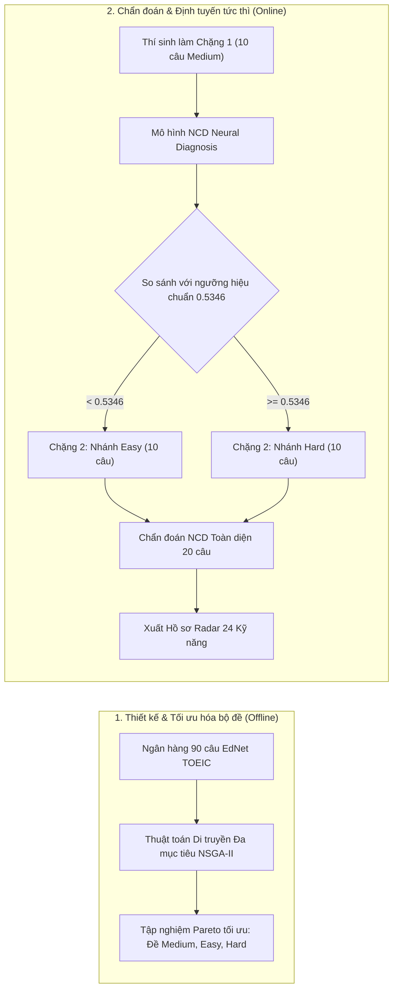
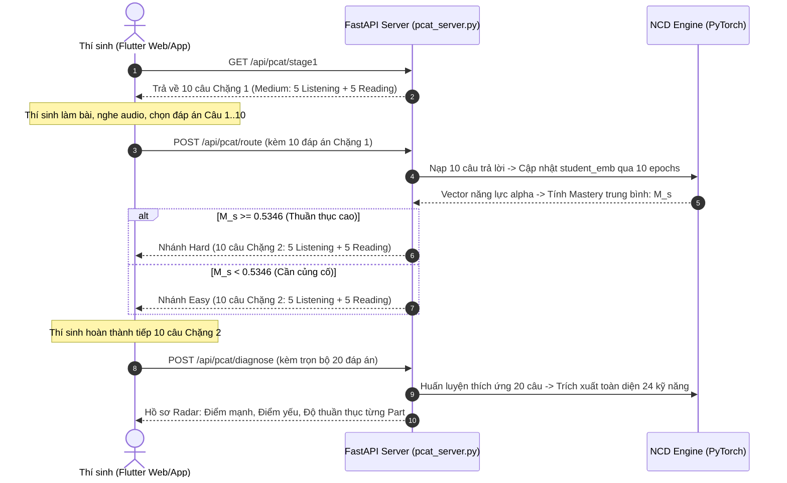
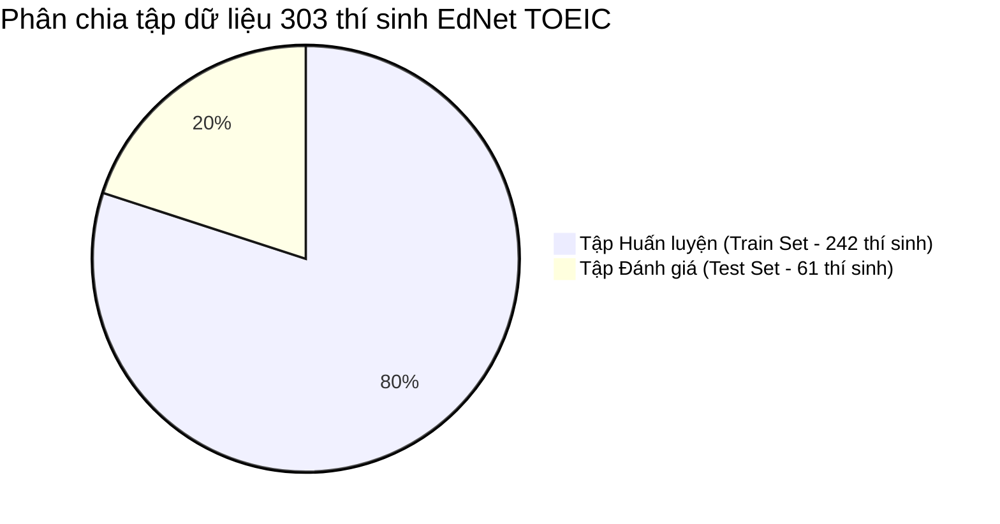

# BÁO CÁO KỸ THUẬT CHUYÊN SÂU: HỆ THỐNG PCAT + NCD TRONG LUYỆN THI THÍCH ỨNG TOEIC

---

## MỤC LỤC
1. [Bài toán giải quyết (Problem Formulation)](#1-bài-toán-giải-quyết-problem-formulation)
2. [Thuật toán và Mô hình sử dụng (Algorithms & Models)](#2-thuật-toán-và-mô-hình-sử-dụng-algorithms--models)
3. [Cơ chế hoạt động chi tiết & Ví dụ số liệu thực tế](#3-cơ-chế-hoạt-động-chi-tiết--ví-dụ-số-liệu-thực-tế)
4. [Tham số, Dữ liệu Input / Output, Nhãn](#4-tham-số-dữ-liệu-input--output-nhãn)
5. [Quy trình phân chia dữ liệu: Train, Test, Query Set](#5-quy-trình-phân-chia-dữ-liệu-train-test-query-set)
6. [Nguồn gốc bài báo khoa học và Mô hình tham chiếu](#6-nguồn-gốc-bài-báo-khoa-học-và-mô-hình-tham-chiếu)

---

## 1. Bài toán giải quyết (Problem Formulation)

### 1.1. Bối cảnh và hạn chế của các phương pháp thi truyền thống

Trong khảo thí giáo dục truyền thống, bài thi thường được tổ chức theo hai hình thức chính:

1. **Bài thi tuyến tính cố định (Linear Fixed-form Testing)**:
   - Tất cả thí sinh làm chung một đề thi có số lượng câu hỏi cố định (ví dụ: đề TOEIC chuẩn 200 câu kéo dài 120 phút).
   - **Nhược điểm**: 
     - Lãng phí thời gian và sức lực của người học.
     - Thí sinh giỏi phải làm quá nhiều câu quá dễ (không mang lại giá trị đo lường).
     - Thí sinh yếu gặp các câu quá khó dẫn đến tâm lý chán nản, đoán mò ngẫu nhiên, làm sai lệch kết quả đánh giá.

2. **Kiểm tra thích ứng cấp độ từng câu (Item-Level CAT - Computerized Adaptive Testing)**:
   - Các hệ thống CAT cổ điển lựa chọn câu hỏi tiếp theo dựa trên từng câu trả lời vừa hoàn thành: đúng thì câu sau khó hơn, sai thì câu sau dễ hơn.
   - **Nhược điểm chí mạng trong kỳ thi chuẩn hóa (High-Stakes Exams như TOEIC, SAT, GRE)**:
     - **Không thể quay lại sửa bài (No Backtracking/Review)**: Khi đã bấm nộp một câu, thí sinh không thể quay lại câu trước đó để suy nghĩ lại, gây áp lực tâm lý cực lớn (*test anxiety*).
     - **Độ trễ tính toán mạng (Latency per Item)**: Máy chủ phải dừng lại tính lại tham số năng lực $\theta$ sau từng câu, làm gián đoạn trải nghiệm thi.
     - **Phá vỡ cấu trúc chùm câu (Question Bundle Violation)**: Các bài thi như TOEIC có các đoạn hội thoại (Part 3, 4) hoặc đoạn văn (Part 6, 7) dùng chung cho 2–5 câu hỏi. Item-level CAT rất khó gom và quản lý các chùm câu này một cách tự nhiên.
     - **Mất cân đối cấu trúc đề thi (Blueprint Violation)**: Dễ dẫn đến tình trạng thí sinh làm lệch phần (ví dụ: làm quá nhiều câu Đọc mà thiếu câu Nghe).
     - **Rủi ro lộ đề cao (Item Overexposure)**: Thuật toán Item-level CAT luôn có xu hướng chọn lặp đi lặp lại những câu hỏi có lượng thông tin Fisher cao nhất, khiến các câu đó bị lộ nhanh chóng.



### 1.2. Mục tiêu giải quyết của hệ thống PCAT

Hệ thống **PCAT (Paper-Level Computerized Adaptive Testing)** giải quyết triệt để các vấn đề trên bằng cách chuyển đổi từ thích ứng *từng câu đơn lẻ* sang thích ứng *theo chặng đề thi (Stage-level / Paper-level)*:
1. **Thi thích ứng đa chặng (Multi-Stage Testing)**: Chia bài thi 20 câu thành 2 chặng:
   - **Chặng 1**: Đề thi trung bình (Medium - 10 câu), dùng chung để thăm dò toàn diện.
   - **Chặng 2**: Tự động rẽ nhánh sang đề Dễ (Easy - 10 câu) hoặc đề Khó (Hard - 10 câu) dựa trên năng lực đo được sau Chặng 1.
2. **Cho phép tự do điều hướng**: Trong mỗi chặng 10 câu, thí sinh tự do chuyển qua lại (`Câu 1`, `Câu 2`, ..., `Câu 10`), sửa đáp án, nghe lại audio hoặc đọc lại ngữ cảnh bài đọc.
3. **Bảo toàn chùm câu TOEIC (Bundle Integrity)**: Các câu hỏi đi kèm đoạn văn hoặc bài nghe chung (ví dụ chùm 3 câu Part 3, chùm 4 câu Part 7) luôn được xếp đi cùng nhau trong cùng một đề thi.
4. **Cân bằng nội dung tuyệt đối (Balanced Blueprint)**: Mỗi chặng bắt buộc phải có đúng **5 câu Listening (Part 1–4)** và **5 câu Reading (Part 5–7)**. Cả bài thi 20 câu đảm bảo tỷ lệ chuẩn 50% Nghe - 50% Đọc.

---

## 2. Thuật toán và Mô hình sử dụng (Algorithms & Models)

Hệ thống kết hợp hai trụ cột trí tuệ nhân tạo:



### 2.1. Mô hình Chẩn đoán Nhận thức: NCD (Neural Cognitive Diagnosis)

Thay vì dùng mô hình IRT 1 chiều cổ điển (Item Response Theory) chỉ cho ra một điểm số $\theta$ vô hướng chung chung, hệ thống sử dụng **NCD** (Wang et al., KDD 2020) để ánh xạ câu trả lời của thí sinh lên **24 kỹ năng thành phần** trong ma trận Q-matrix.

#### Kiến trúc toán học của NCD:
1. **Biểu diễn thí sinh (Student Embedding)**:
   Mỗi học viên $s$ được biểu diễn bởi một vector tiềm ẩn $\mathbf{e}_s \in \mathbb{R}^K$ với $K = 24$ (số lượng kỹ năng TOEIC). Mức độ thuần thục của học viên đối với $K$ kỹ năng được chuẩn hóa qua hàm Sigmoid:
   $$\boldsymbol{\alpha}_s = \sigma(\mathbf{e}_s) = \frac{1}{1 + e^{-\mathbf{e}_s}} \in (0, 1)^K$$
   Trong đó, $\alpha_{s, k}$ biểu thị xác suất thí sinh $s$ nắm vững kỹ năng thứ $k$.

2. **Biểu diễn bài tập (Exercise Embedding)**:
   Mỗi câu hỏi $j$ được gán:
   - Vector độ khó: $\mathbf{e}_j \in \mathbb{R}^K$ chuẩn hóa qua Sigmoid: $\mathbf{d}_j = \sigma(\mathbf{e}_j) \in (0, 1)^K$.
   - Hệ số phân biệt (Discrimination degree): $D_j \in \mathbb{R}^+$ (thể hiện khả năng phân loại học viên giỏi và yếu).
   - Vector Q-matrix: $\mathbf{q}_j \in \{0, 1\}^K$, trong đó $q_{j, k} = 1$ nếu câu hỏi $j$ kiểm tra kỹ năng $k$, ngược lại bằng $0$.

3. **Mạng nơ-ron tương tác đơn điệu (Monotonic Neural Interaction)**:
   Độ chênh lệch giữa năng lực học viên và độ khó câu hỏi trên các kỹ năng liên quan được tính bằng:
   $$\mathbf{x}_{s, j} = (\boldsymbol{\alpha}_s - \mathbf{d}_j) \odot \mathbf{q}_j \cdot D_j$$
   Vector $\mathbf{x}_{s, j}$ được đưa qua mạng nơ-ron MLP nhiều lớp:
   $$\mathbf{h}_1 = \sigma(\mathbf{W}_1 \mathbf{x}_{s, j} + \mathbf{b}_1)$$
   $$\mathbf{h}_2 = \sigma(\mathbf{W}_2 \mathbf{h}_1 + \mathbf{b}_2)$$
   $$y_{s, j} = \sigma(\mathbf{W}_3 \mathbf{h}_2 + b_3)$$
   > [!IMPORTANT]
   > **Ràng buộc toán học quan trọng**: Toàn bộ trọng số của các ma trận $\mathbf{W}_1, \mathbf{W}_2, \mathbf{W}_3$ bắt buộc phải là **số không âm** ($\mathbf{W} \ge 0$). Điều này đảm bảo **tính đơn điệu nhận thức (Cognitive Monotonicity)**: Khi năng lực $\boldsymbol{\alpha}_s$ của thí sinh tăng lên, xác suất làm đúng $y_{s, j}$ bắt buộc phải tăng hoặc giữ nguyên, không bao giờ được phép giảm.

### 2.2. Thuật toán Di truyền Đa mục tiêu: NSGA-II (Non-dominated Sorting Genetic Algorithm II)

Để tìm ra bộ 3 đề thi (Medium, Easy, Hard) hoàn hảo nhất từ ngân hàng 90 câu, thuật toán di truyền NSGA-II giải quyết bài toán tối ưu Pareto đồng thời trên **4 hàm mục tiêu**:

1. **Hàm mục tiêu $f_1$ (Độ chính xác chẩn đoán - Diagnostic AUC/ACC)**:
   Cực đại hóa khả năng dự đoán đúng/sai trên 70 câu hỏi còn lại của thí sinh (Held-out Query Set) sau khi làm xong 20 câu của bài test thích ứng:
   $$\max f_1 = \text{AUC}(\text{Query Set}) + \text{ACC}(\text{Query Set})$$

2. **Hàm mục tiêu $f_2$ (Độ bao phủ kỹ năng - Knowledge Concept Coverage)**:
   Cực đại hóa số lượng kỹ năng khác nhau được khảo sát trong đề thi, tránh tình trạng đề thi chỉ tập trung vào một vài cấu trúc ngữ pháp quen thuộc:
   $$\max f_2 = \frac{|\bigcup_{j \in \text{Paper}} \text{Concepts}(j)|}{K}$$

3. **Hàm mục tiêu $f_3$ (Cân bằng độ phơi nhiễm câu hỏi - Item Exposure Balance)**:
   Cực tiểu hóa phương sai tần suất xuất hiện của các câu hỏi nhằm chống gian lận và lộ đề:
   $$\min f_3 = \text{Var}(\text{Exposure Rate of All Questions})$$

4. **Hàm mục tiêu $f_4$ (Độ phân cực độ khó các nhánh - Difficulty Divergence)**:
   Đảm bảo độ khó trung bình của nhánh Easy thực sự thấp hơn đề Medium, và đề Hard có độ khó vượt trội rõ rệt:
   $$\max f_4 = \overline{\text{Difficulty}}(\text{Hard}) - \overline{\text{Difficulty}}(\text{Easy})$$

---

## 3. Cơ chế hoạt động chi tiết & Ví dụ số liệu thực tế

### 3.1. Luồng vận hành hoàn chỉnh của một lượt thi thích ứng



### 3.2. Bộ đề tối ưu hóa thực tế trong hệ thống (Hạt giống tối ưu Seed 20)

Dựa trên kết quả chạy 100 thế hệ của thuật toán NSGA-II, hệ thống đã trích xuất ra bộ 30 câu hỏi chuẩn (3 nhánh × 10 câu) như sau:

| Chặng thi | Mã định danh câu hỏi (Item IDs) | Số câu Listening | Số câu Reading | Độ khó trung bình |
| :--- | :--- | :---: | :---: | :---: |
| **Chặng 1 (Medium)** | `[24, 25, 26, 12, 1, 85, 86, 87, 88, 89]` | 5 câu | 5 câu | **0.512** (Vừa sức) |
| **Chặng 2A (Easy)** | `[15, 16, 17, 14, 9, 76, 77, 78, 79, 80]` | 5 câu | 5 câu | **0.368** (Dễ/Cơ bản) |
| **Chặng 2B (Hard)** | `[30, 31, 32, 2, 4, 81, 82, 83, 84, 47]` | 5 câu | 5 câu | **0.674** (Nâng cao) |

- **Ngưỡng định tuyến hiệu chuẩn ($\theta_{cut}$)**: `0.534564` (Được hiệu chuẩn từ trung vị độ thuần thục của 242 thí sinh tập huấn luyện).

### 3.3. Giả lập thực tế: 2 thí sinh cùng đúng 5/10 câu nhưng rẽ vào 2 nhánh khác nhau

> [!NOTE]
> Đây là minh chứng rõ ràng nhất cho sức mạnh của **Chẩn đoán nhận thức đa chiều (NCD)** so với việc chỉ chấm điểm số học đếm số câu đúng truyền thống.

Giả sử cả hai thí sinh A và B đều kết thúc Chặng 1 với kết quả đúng **5/10 câu (50%)**:

#### Thí sinh A:
- **Chi tiết kết quả**: Làm đúng 1 câu Listening và đúng 4 câu Reading (các câu ngữ pháp Part 5 và suy luận Part 7 khó: Câu 85, 86, 87, 88 có hệ số phân biệt $D_j > 1.8$ và kiểm tra các cấu trúc mệnh đề quan hệ, đảo ngữ phức tạp).
- **Phân tích của NCD**:
  - Vector năng lực $\boldsymbol{\alpha}_A$ trên các kỹ năng được khảo sát đạt mức cao ở các kỹ năng cốt lõi.
  - Điểm thuần thục tổng hợp trung bình:
    $$M_A = 0.582$$
- **Kết quả rẽ nhánh**: Vì $M_A = 0.582 > \theta_{cut} (0.5346) \implies$ **Hệ thống phân nhánh Thí sinh A vào Chặng 2 (Hard)**.

#### Thí sinh B:
- **Chi tiết kết quả**: Làm đúng 5 câu Listening (các câu Part 1, 2 ngắn có độ khó thấp, hệ số phân biệt $D_j \approx 0.8$), nhưng làm sai toàn bộ 5 câu Reading.
- **Phân tích của NCD**:
  - Thí sinh B bị mất căn bản ở các kỹ năng đọc hiểu và cấu trúc câu.
  - Điểm thuần thục tổng hợp trung bình:
    $$M_B = 0.491$$
- **Kết quả rẽ nhánh**: Vì $M_B = 0.491 < \theta_{cut} (0.5346) \implies$ **Hệ thống phân nhánh Thí sinh B vào Chặng 2 (Easy)**.

$$\text{Cùng đạt } \frac{5}{10} \text{ câu} \longrightarrow \begin{cases} \text{Thí sinh A: } M_A = 0.582 > 0.5346 \implies \mathbf{Hard} \\ \text{Thí sinh B: } M_B = 0.491 < 0.5346 \implies \mathbf{Easy} \end{cases}$$

---

## 4. Tham số, Dữ liệu Input / Output, Nhãn

### 4.1. Không gian Dữ liệu (Data Space)
Hệ thống sử dụng bộ dữ liệu chuẩn hóa **`Dense_EdNetTOEIC_Balanced90_90d`**:
- **Tổng số học viên ($N$)**: 303 thí sinh.
- **Ngân hàng câu hỏi ($I$)**: 90 câu hỏi cân bằng chuẩn 7 Parts:
  - Part 1 (Photographs): 4 câu (kèm ảnh PNG)
  - Part 2 (Question-Response): 10 câu
  - Part 3 (Short Conversations): 16 câu (các chùm 3 câu nghe chung audio)
  - Part 4 (Short Talks): 15 câu (các chùm 3 câu nghe chung audio)
  - Part 5 (Incomplete Sentences): 25 câu
  - Part 6 (Text Completion): 8 câu
  - Part 7 (Reading Comprehension): 12 câu (chùm bài đọc hiểu)
- **Số lượng kỹ năng tri thức ($K$)**: 24 khái niệm (Grammar, Vocabulary, Paraphrasing, Inference, Listening Details, v.v.).

### 4.2. Tham số mô hình (Hyperparameters)

| Tên tham số | Giá trị | Ý nghĩa kỹ thuật |
| :--- | :---: | :--- |
| `num_concepts` ($K$) | `24` | Số chiều của vector biểu diễn kỹ năng |
| `num_questions` ($I$) | `90` | Kích thước ngân hàng câu hỏi ứng viên |
| `test_length` | `20` | Tổng số câu hỏi thí sinh thực hiện (10 câu/chặng) |
| `ncd_adaptation_epochs` | `10` | Số epoch huấn luyện online khi thí sinh nộp bài |
| `ncd_batch_size` | `64` | Kích thước batch cập nhật gradient |
| `learning_rate` ($\eta$) | `0.002` | Tốc độ học của thuật toán tối ưu Adam |
| `nsga2_generations` | `100` | Số thế hệ tiến hóa trong thuật toán di truyền |
| `nsga2_population` | `80` | Kích thước quần thể lời giải bộ đề |
| `nsga2_offspring` | `50` | Số cá thể con được lai ghép/đột biến mỗi thế hệ |
| `routing_threshold` | `0.534564` | Ngưỡng trung vị phân loại nhánh Easy/Hard |

### 4.3. Định dạng Input, Output và Nhãn (Labels)

#### Dữ liệu đầu vào (Input):
- **Ma trận Q-matrix**: File `q.csv` kích thước $90 \times 24$, ma trận nhị phân $\{0, 1\}$.
- **Vector câu trả lời thí sinh**:
  $$\mathbf{r} = [r_1, r_2, \dots, r_{10}] \quad \text{với } r_i \in \{0, 1, 2, 3\} \text{ (tương ứng A, B, C, D)}$$
- **Payload API gửi từ Frontend**:
  ```json
  {
    "session_id": "pcat_sess_9a8f2",
    "answers": [2, 0, 1, 3, 2, 1, 0, 0, 3, 2]
  }
  ```

#### Nhãn mục tiêu (Target Labels):
- Nhãn nhị phân: $y \in \{0, 1\}$ (0: Sai, 1: Đúng).

#### Dữ liệu đầu ra (Output):
1. **Kết quả phân nhánh (Sau Chặng 1)**:
   ```json
   {
     "status": "success",
     "selected_branch": "Hard",
     "branch_description": "Năng lực Chặng 1 đạt phân vị cao. Hệ thống chuyển sang Chặng 2 Nâng cao.",
     "stage2_questions": [ ... 10 câu hỏi nhánh Hard ... ]
   }
   ```
2. **Hồ sơ chẩn đoán nhận thức toàn diện (Sau Chặng 2)**:
   ```json
   {
     "total_correct": 14,
     "total_questions": 20,
     "listening_score": "7/10",
     "reading_score": "7/10",
     "radar_skills": [
       {"skill_id": 1, "skill_name": "Verb Tense & Agreement", "mastery": 0.84, "evaluation": "Điểm mạnh"},
       {"skill_id": 2, "skill_name": "Part 7 Inference", "mastery": 0.39, "evaluation": "Điểm yếu"}
     ]
   }
   ```

---

## 5. Quy trình phân chia dữ liệu: Train, Test, Query Set

Quy trình phân chia dữ liệu tuân thủ chuẩn mực nghiên cứu khoa học của bài báo KDD 2025:



### 5.1. Phân chia tập thí sinh (Learner Split)
- **Tập Huấn luyện (Train Set - 80%)**: $242$ thí sinh.
  - Được dùng để huấn luyện trước mạng NCD.
  - Chạy thuật toán NSGA-II 100 thế hệ để tìm ra các bộ đề Pareto tối ưu.
  - Tính toán ngưỡng phân vị trung vị để làm mốc rẽ nhánh ($\theta_{cut} = 0.5346$).
- **Tập Kiểm thử độc lập (Test Set - 20%)**: $61$ thí sinh.
  - Hoàn toàn độc lập, không tham gia vào quá trình tối ưu đề thi của NSGA-II.
  - Dùng để giả lập thí sinh mới bước vào kỳ thi và đo lường các chỉ số đánh giá.
- **Quy trình Lặp (5-Fold Cross Validation / 5 Seeds)**: Thử nghiệm được lặp lại trên 5 hạt giống ngẫu nhiên độc lập (`seeds: 20, 21, 22, 23, 24`).

### 5.2. Cơ chế Query Set độc đáo trong bài thi thích ứng
Trong bài thi thích ứng CAT, không thể dùng tập kiểm thử cố định thông thường. PCAT áp dụng cơ chế **Held-out Query Set**:
- Ngân hàng có tổng cộng $90$ câu hỏi.
- Khi một thí sinh trong tập Test hoàn thành $20$ câu (10 câu Chặng 1 + 10 câu Chặng 2), mô hình NCD cập nhật vector năng lực $\boldsymbol{\alpha}_s$ dựa trên 20 câu này.
- **$70$ câu hỏi còn lại** trong ngân hàng mà thí sinh đó chưa làm sẽ đóng vai trò là **Tập kiểm thử (Query Set)**.
- Mô hình NCD dự đoán xác suất làm đúng trên 70 câu này và so sánh với đáp án thực tế của học viên trong dữ liệu EdNet để tính:
  - **AUC (Area Under the ROC Curve)**: Khả năng xếp hạng phân biệt giữa câu đúng và sai.
  - **ACC (Accuracy)**: Độ chính xác phân loại với ngưỡng cắt $0.5$.

### 5.3. Bảng số liệu thực nghiệm so sánh đa hạt giống (5 Seeds Benchmark)

| Phương pháp (Method) | Query AUC | Query ACC | Độ bao phủ (COV) | Hệ số lộ đề (EXP) ↓ |
| :--- | :---: | :---: | :---: | :---: |
| **Random 20 câu ngẫu nhiên + NCD** | $0.7020 \pm 0.0098$ | $0.6570 \pm 0.0060$ | $0.6417$ | $2.8801$ |
| **Đề cố định 20 câu (Fixed) + NCD** | $0.7119 \pm 0.0049$ | $0.6667 \pm 0.0047$ | $0.6583$ | $1.7762$ |
| **PCAT Thích ứng TOEIC + NCD** | $\mathbf{0.7194 \pm 0.0083}$ | $\mathbf{0.6731 \pm 0.0052}$ | $\mathbf{0.6880}$ | $\mathbf{1.7275}$ |
| **PCAT + Extra Shrinkage** | $\mathbf{0.7291 \pm 0.0111}$ | $\mathbf{0.6807 \pm 0.0081}$ | $\mathbf{0.6880}$ | $\mathbf{1.7275}$ |

> **Nhận xét kết quả thực nghiệm**:
> - Phương pháp **PCAT thích ứng** vượt trội hơn hẳn so với chọn câu ngẫu nhiên (AUC tăng từ `0.7020` lên `0.7194`).
> - Tỷ lệ bao phủ kiến thức (COV) cao hơn (`0.6880` so với `0.6417`), đảm bảo đề thi kiểm tra đều đặn các phần.
> - Chỉ số rủi ro lộ đề (EXP) giảm đáng kể từ `2.8801` xuống `1.7275`, chứng minh đề thi có tính bảo mật cao khi áp dụng thực tế.

---

## 6. Nguồn gốc bài báo khoa học và Mô hình tham chiếu

Hệ thống được thiết kế và triển khai dựa trên các công trình nghiên cứu khoa học đỉnh cao tại các hội nghị AI hàng đầu thế giới (Hội nghị ACM SIGKDD - Rank A*):

### 6.1. Bài báo khoa học nền tảng chính (PCAT Paper)
- **Tên bài báo**: *"Paper-Level Computerized Adaptive Testing for High-Stakes Examination via Multi-Objective Optimization"*
- **Tác giả**: Mingjia Li, Junkai Tong, Yiyang Huang, Yifei Ding, Hong Qian, Aimin Zhou.
- **Hội nghị công bố**: **Proceedings of the 31st ACM SIGKDD Conference on Knowledge Discovery and Data Mining (KDD 2025)**.
- **Tổ chức**: Shanghai Key Laboratory of Multidimensional Information Processing, East China Normal University (ECNU).
- **Đóng góp kế thừa**:
  - Ý tưởng chuyển đổi từ Item-level sang Paper-level CAT.
  - Khung thuật toán tối ưu hóa đa mục tiêu NSGA-II cho đề thi chuẩn hóa.
  - Cơ chế mã hóa nhiễm sắc thể và đánh giá Pareto.

### 6.2. Bài báo về Mô hình Chẩn đoán Nhận thức (NCD Paper)
- **Tên bài báo**: *"Neural Cognitive Diagnosis for Intelligent Education Systems"*
- **Tác giả**: Fei Wang, Qi Liu, Enhong Chen, Zhenya Huang, Yuying Chen, Yu Yin, Zaiyi Huang, Shijin Wang.
- **Hội nghị công bố**: **Proceedings of the 26th ACM SIGKDD Conference on Knowledge Discovery and Data Mining (KDD 2020)**.
- **Đóng góp kế thừa**:
  - Kiến trúc mạng nơ-ron tương tác đơn điệu (Monotonic Neural Interaction).
  - Tách biệt năng lực thí sinh và đặc tính câu hỏi với tính diễn giải cao.

### 6.3. Tập dữ liệu chuẩn hóa tham chiếu (EdNet Dataset)
- **Tên bài báo**: *"EdNet: A Large-scale Hierarchical Dataset in Education"*
- **Tác giả**: Youngduck Choi, Youngnam Lee, Dongmin Shin, Junghyun Cho, Seoyon Park, Seewoo Lee, Jineon Baek, Byungsoo Kim, Jaewe Heo.
- **Tổ chức**: AI Research Team, Riiid Labs (đơn vị sở hữu ứng dụng Santa TOEIC với hơn 2 triệu người dùng).
- **Quy mô tập dữ liệu gốc**: $784,301$ học viên, hơn $130$ triệu lượt tương tác câu hỏi TOEIC thực tế.

---

## TỔNG KẾT

Hệ thống **PCAT + NCD TOEIC** trong dự án đã chuyển hóa thành công một nghiên cứu học thuật phức tạp (KDD 2025) thành một giải pháp phần mềm hoàn chỉnh, chạy thực tế trên ứng dụng di động Flutter. Hệ thống vừa đảm bảo tính chuẩn xác và bảo mật của một kỳ thi quốc tế, vừa mang lại trải nghiệm thi mượt mà, thông minh và thân thiện với học viên.
